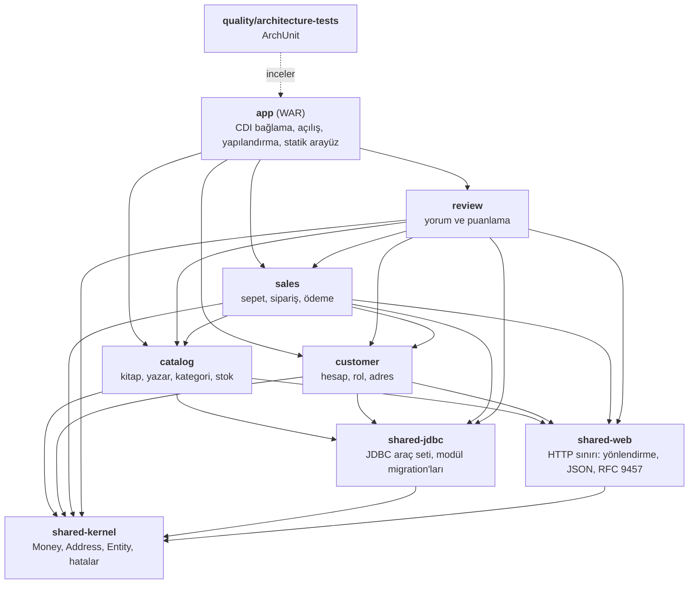
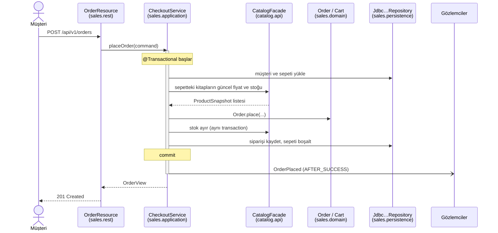
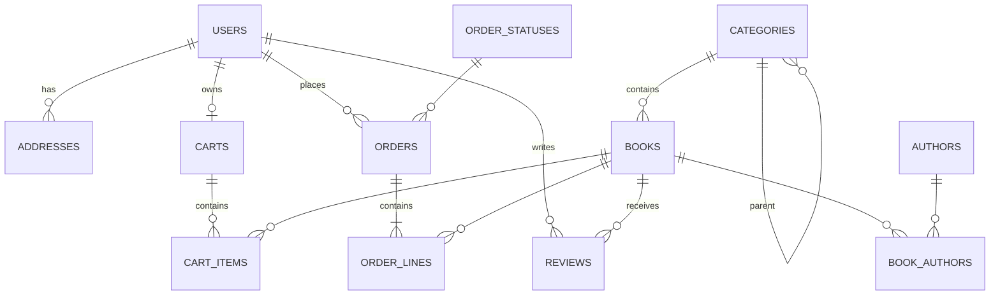

# Book Store — Mimari

Bu doküman sistemin **nasıl** kurulduğunu anlatır. **Ne** yaptığı [SPEC.md](SPEC.md), kararların gerekçeleri [docs/adr](adr/README.md), müfredatla ilişkisi [CURRICULUM-MAP.md](CURRICULUM-MAP.md) içindedir.

> **Mevcut durum ve hedef.** Bu doküman **hedef mimariyi** anlatır. Faz 4.1 ile modül yapısı hedefe ulaştı: kod iş alanına göre modüllerde duruyor ve modüller birbirini yalnızca `api` paketleriyle kullanıyor. Faz 4.2 ile ADR-0003–0008'in kuralları ArchUnit testi oldu; Faz 4.3 ile domain modeli tipli kimlikler, `DomainException` ve `Specification` ile dersle hizalandı. Faz 4 ve 5 tamamlandı; elle yazılmış bir REST API var. Henüz yapılmayanlar *(uygulama sunucusu, güvenlik ve arayüz)* Faz 6–7'de; bölüm 9 kalan farkları listeler.

## 1. Genel bakış

Book Store, tek bir uygulama olarak dağıtılan, içi iş alanlarına göre modüllere ayrılmış bir **modüler monolittir** *(ADR-0002)*. Her iş modülünün içi **hexagonal** düzendedir: iş kuralları merkezdeki `domain` paketindedir ve hiçbir framework'e bağlı değildir; veritabanı ve HTTP, domain'in tanımladığı arayüzleri uygulayan adaptörlerdir.

| Konu | Seçim | ADR |
| --- | --- | --- |
| Dil | Java 21 | — |
| Derleme | Maven, Maven Wrapper | 0002 |
| Platform | Jakarta EE 11 Web Profile, MicroProfile 6.1, Payara Micro 7 | 0010 |
| Bağımlılık enjeksiyonu | CDI *(Faz 4–5'te elle yazılmış composition root)* | 0006, 0010 |
| HTTP | Jakarta REST *(JAX-RS)*, JSON-B, Bean Validation *(Faz 5'te JDK HTTP sunucusu ve Jackson)* | 0009, 0010 |
| Hata biçimi | RFC 9457 Problem Details | 0009 |
| Veritabanı | PostgreSQL 17; testlerde H2 *(PostgreSQL modu)* ve Testcontainers | 0008 |
| Veri erişimi | Elle yazılmış JDBC | 0008 |
| Şema | Flyway | 0008 |
| Transaction | JTA `@Transactional` *(Faz 4–5'te `TransactionRunner` portu)* | 0008, 0010 |
| Arayüz | WAR içinde HTML, CSS, JavaScript; REST API'nin istemcisi | 0011 |
| Test | JUnit, AssertJ, ArchUnit, Testcontainers, JerseyTest | 0003, 0008, 0010 |
| Dal stratejisi | Doğrudan `main`, yayınlarda CalVer etiketi | 0017 |

## 2. Modüller



| Modül | Sorumluluk | Örnek tipler |
| --- | --- | --- |
| `shared-kernel` | Hiçbir iş modülüne ait olmayan genel tipler | `Money`, `Address`, `Entity`, `DomainEvent`, `TransactionRunner`, `Page<T>`, `TextNormalizer`, `Guard`, `DomainException`, `Identifier`, `BookId`, `CustomerId`, `Specification<T>` |
| `shared-jdbc` | İş modüllerinin `persistence` paketlerinin kullandığı teknik JDBC araç seti *(ADR-0018)* | `JdbcExecutor`, `JdbcTransactionRunner`, `RecordRowMapper`, `ModuleMigrations` |
| `shared-web` | İş modüllerinin `rest` paketlerinin kullandığı, elle yazılmış HTTP sınırı *(ADR-0019)*; Faz 6'da JAX-RS'e devredilir | `HttpApi`, `Routes`, `WebRequest`, `Json`, `RequestValidator`, `ProblemMapper`, `Caller` |
| `catalog` | Satılan kitaplar, stokları ve puan özetleri | `Book`, `Author`, `Category`, `Isbn`, `Stock`, `RatingSummary`; api: `StockFacade`, `RatingFacade`, `BookOffer` |
| `customer` | Kayıtlı kullanıcılar, roller, adres defteri | `Customer`, `Email`, `PersonName`, `SavedAddress`, `PasswordPolicy`; api: `CustomerDirectory` |
| `sales` | Sepet, sipariş verme, ödeme, sipariş durumları | `Cart`, `Order`, `OrderStatus`, `OrderNumber`, `ProductSnapshot`, `ShippingPolicy`; api: `PurchaseHistory` |
| `review` | Yorum, puanlama ve puan dağılımı | `Review`, `Rating`, `RatingDistribution` |
| `app` | Giriş noktası: nesneleri bağlar, migration'ları çalıştırır, arayüzü sunar | `BookstoreModule` *(elle yazılmış composition root)*; Faz 6'da `BookstoreWiring`, `BookstoreStartup` |
| `quality/architecture-tests` | Mimari kuralların ArchUnit testleri | Modül sınırı, paket matrisi, domain, kodlama, application, olay ve persistence kuralları |

İş modülleri arasındaki bağımlılıklar döngüsüzdür ve bir modül diğerinin yalnızca `api` paketini kullanır *(ADR-0002, ADR-0003)*. Bugünkü modüller arası sözleşmeler:

| Kullanan | Sözleşme | Ne için |
| --- | --- | --- |
| `sales` | `catalog.api.StockFacade` | Sepette ve siparişte güncel fiyat ve stok; stok ayırma ve iptalde geri bırakma |
| `sales` | `customer.api.CustomerDirectory` | Siparişe kopyalanan teslimat adresi |
| `review` | `catalog.api.RatingFacade` | Kitabın puan özetini yorumla aynı işlemde güncellemek |
| `review` | `sales.api.PurchaseHistory` | Yalnızca kitabı teslim almış müşteri yorum yazabilir |
| `review` | `customer.api.CustomerDirectory` | Yorumun yanında görünen kısa ad |

`sales` modülü kitap bilgisini kendi `ProductSnapshot` değerine çevirerek kullanır *(Mapper: `sales.application.Products`)*; sepet ve sipariş `catalog`'un `Book` sınıfını görmez.

## 3. Bir iş modülünün içi

Her iş modülü aynı beş paketi taşır; örnek `sales` için:

```
com.bookstore.sales
  ├─ api            komutlar, DTO'lar, façade arayüzleri         PlaceOrderCommand, OrderView, CheckoutFacade
  ├─ application    kullanım senaryoları, mapper'lar             CheckoutService, OrderMapper
  ├─ domain         aggregate'ler, değer nesneleri, olaylar,     Order, Cart, OrderStatus, OrderPlaced,
  │                 repository arayüzleri ve diğer portlar       OrderRepository, PaymentGateway
  ├─ persistence    JDBC repository'leri                         JdbcOrderRepository, JdbcCartRepository
  └─ rest           JAX-RS kaynakları, istek record'ları         OrderResource, PlaceOrderRequest
resources/db/migration/sales                                     V1__sales.sql
```

Paketler arasındaki izinli yönler *(ADR-0003)*:

| **Kimden/Kime (->)** | **domain** | **api** | **application** | **persistence** | **rest** | **shared-kernel** |
| --- | :---: | :---: | :---: | :---: | :---: | :---: |
| **domain** | - | X | X | X | X | Ok |
| **api** | X | - | X | X | X | Ok |
| **application** | Ok | Ok | - | X | X | Ok |
| **persistence** | Ok | X | X | - | X | Ok |
| **rest** | X | Ok | X | X | - | Ok |
| **shared-kernel** | X | X | X | X | X | - |

### Domain

- **Değer nesneleri** `record`'dur ve kurucuda doğrulanır: `Money`, `Isbn`, `Email`, `Address`, `Rating`, `Stock`, `OrderNumber`.
- **Aggregate'ler** kimliği olan, kendi kurallarını koruyan sınıflardır. Kimlikler tiplidir *(`BookId`, `OrderId` …)* ve başka aggregate'lere yalnızca kimlikle referans verilir *(ADR-0004)*.
- Durum değişiklikleri setter ile değil, niyet bildiren metotlarla yapılır: `book.reserve(2)`, `order.markPaid(clock)`.
- **Sipariş durumu** bir state machine'dir: `CREATED → PAID → SHIPPED → DELIVERED`, ayrıca `CREATED` ve `PAID`'den `CANCELLED`.
- **Kargo ücreti** `ShippingPolicy` stratejisidir; **arama** `Specification<Book>`'lardan kurulur.
- **Olaylar** aggregate'te biriktirilir *(`raise`)*, servis kayıttan sonra toplar *(`pullEvents`)* *(ADR-0007)*.
- **Hatalar** `DomainException`'dan türer ve bir `Kind` *(`NOT_FOUND`, `CONFLICT`, `RULE_VIOLATION`, `FORBIDDEN`)* ile kararlı bir `code` taşır.
- Kayıtlı bir aggregate `reconstitute(...)` ile oluşturulur; bu metot olay üretmez ve durum kurallarını çalıştırmaz.

### Application

Her kullanım senaryosu, `api` paketindeki bir façade arayüzünün metodudur. Tipik bir metot:

1. Bir **komut** `record`'u alır ve değer nesnelerine çevirerek doğrular; geçersiz istek transaction açmaz.
2. Bir transaction içinde *(`@Transactional`)* aggregate'leri repository'lerden yükler; başka modüllerden ihtiyaç duyduğu bilgiyi onların façade'larından ister.
3. İş kuralını aggregate'e yaptırır, sonucu kaydeder.
4. Olayları toplayıp `DomainEventPublisher`'a verir *(önce kayıt, sonra yayın)*.
5. Sonucu mapper ile bir **DTO**'ya çevirip döner; domain nesnesi dışarı çıkmaz.

Modüller arası bir örnek, sipariş verme:



Sipariş öncesinde sepet ayrı bir transaction'da güncel katalogla karşılaştırılır; fiyat ya da stok değiştiyse sipariş verilmez *(ADR-0014)*. Kartla ödemede ödeme bu akışın içinde alınır ve sipariş `PAID` olur; reddedilirse transaction geri alınır *(ADR-0013)*.

### Persistence

- Domain'deki her repository arayüzü için bir `Jdbc…Repository` vardır. Yalnızca `PreparedStatement` ve parametreli sorgu kullanılır.
- `JdbcExecutor`, bağlantı alma, bağlama, çalıştırma ve kapatma adımlarını tek yerde yapar *(Template Method)*; repository'ler SQL'i ve bir `RowMapper` verir. Düz satırlar `RecordRowMapper` ile `record`'lara okunur.
- Repository'ler transaction yönetmez *(commit, rollback yok)*; transaction kullanım senaryosuna aittir.
- Toplu okumalar sabit sayıda sorgu kullanır *(N+1 yok)*. Kitap araması `Specification`'lardan SQL üretir; Türkçe duyarsızlık için normalleştirilmiş anahtar sütunları kullanılır *(ADR-0016)*.
- Değişen tablolar `version` sütunu taşır; eski bir kopya yeni kopyanın üzerine yazamaz *(ADR-0015)*.
- `SQLException` teknik hataya sarılır; bilinen kısıt ihlalleri *(benzersiz e-posta, ISBN, yorum)* `DomainException`'a çevrilir.
- Her repository arayüzünün bir sözleşme testi vardır; bellek içi, H2 ve PostgreSQL implementasyonları aynı testten geçer *(ADR-0008)*.

### Rest

- İstek gövdeleri `rest` paketindeki `record`'lara okunur ve Bean Validation ile biçimsel olarak doğrulanır.
- Kaynaklar yalnızca `api` paketindeki façade'ları çağırır.
- Hatalar `Kind`'a göre eşlenir: `NOT_FOUND` 404, `CONFLICT` 409, `RULE_VIOLATION` 422, `FORBIDDEN` 403; biçim hataları 400; beklenmeyen hatalar opak 500. Gövde RFC 9457 biçimindedir *(ADR-0009)*.

## 4. Uygulama sunucusu

`app` modülü `bookstore.war` olarak paketlenir ve Payara Micro 7 üzerinde çalışır *(ADR-0010)*.

| İş | Nasıl |
| --- | --- |
| Nesneleri bağlamak | CDI, `annotated` keşif; servisler ve repository'ler `@ApplicationScoped`. Container'ın kuramadığı `Clock`, `DataSource`, `ShippingPolicy` `BookstoreWiring`'de producer. |
| Veri kaynağı | `@DataSourceDefinition`; bağlantı bilgisi MicroProfile Config ile ortamdan. |
| Açılış | `BookstoreStartup`, CDI `Startup` olayında Flyway migration'larını çalıştırır; `bookstore.demo-data=true` ise örnek katalog yükler. |
| Transaction | Façade uygulamaları `@Transactional`; modüller arası çağrılar aynı JTA transaction'ına katılır. |
| Olaylar | `CdiDomainEventPublisher`; gözlemciler `@Observes(during = AFTER_SUCCESS)`. |
| HTTP | JAX-RS kaynakları `/api/v1`, JSON-B, `ExceptionMapper`. OpenAPI `/openapi`. |
| Arayüz | `src/main/webapp` altındaki HTML, CSS ve JavaScript; API'yi `fetch` ile çağırır *(ADR-0011)*. |
| Güvenlik | Jakarta Security: tarayıcı için oturum, API için HTTP Basic; roller `CUSTOMER`, `ADMIN`; oturum çerezli isteklerde `X-Bookstore-Client` başlığı *(ADR-0020)*. |

## 5. Veritabanı



- Her iş modülü kendi tablolarının ve migration'larının sahibidir: `catalog` *(categories, authors, books, book_authors)*, `customer` *(users, roles, addresses)*, `sales` *(carts, cart_items, orders, order_lines, order_statuses, order_number_sequences)*, `review` *(reviews)*.
- Modüller arası yabancı anahtarlar *(örneğin `order_lines.book_id → books.id`)* veritabanı bütünlüğü için tutulur; kodda modüller birbirinin tablolarını okumaz.
- Tablo ve sütun adları `snake_case`, İngilizce; ayrılmış sözcükler sütun adı olmaz.
- Zamanlar UTC; tutarlar `NUMERIC(12,2)`.
- Sabit değer kümeleri *(durum, rol)* referans tablo ve yabancı anahtarla kısıtlanır *(ADR-0008)*. Diğer kurallar `CHECK` ile: `stock >= 0`, `price > 0`, puan 1–5, sepet adedi 1–10, puan toplamı tutarlılığı.
- `orders` teslimat adresini, `order_lines` sipariş anındaki başlık ve fiyatı kopyalar.

## 6. Güvenlik

| Konu | Yaklaşım |
| --- | --- |
| Kimlik doğrulama | Jakarta Security; tarayıcıda `POST /api/v1/session` ve oturum çerezi, API'de HTTP Basic *(ADR-0020)* |
| Parola | `PasswordHasher` portu, BCrypt uygulaması; `PasswordPolicy` ile kural denetimi |
| Yetkilendirme | Rol kuralları *(`/api/v1/admin/**` → `ADMIN`)* ve servis seviyesinde sahiplik denetimi *(müşteri yalnızca kendi siparişini görür)* |
| SQL enjeksiyonu | Yalnızca `PreparedStatement` *(testle doğrulandı)* |
| XSS | Arayüz, API'den gelen metni `textContent` ile yazar; `innerHTML` ile kullanıcı verisi basılmaz |
| Gizli bilgiler | Bağlantı bilgisi ve parolalar WAR içinde değil, ortamda |

## 7. Test stratejisi

| Katman | Test türü | Araç |
| --- | --- | --- |
| `shared-kernel`, `domain` | Birim testi; dış bağımlılık yok | JUnit, AssertJ |
| `application` | Birim testi; bellek içi repository'ler ve sahte portlar | JUnit, test fixture'ları *(`test-jar`)* |
| `persistence` | Sözleşme testi ve entegrasyon testi | H2 *(her zaman)*, Testcontainers + PostgreSQL 17 *(Docker varsa)* |
| `rest` | HTTP testi | Faz 5: `HttpClient`; Faz 6: JerseyTest |
| Mimari | Paket ve modül kuralları | ArchUnit *(`quality/architecture-tests`)* |
| `app` | Smoke test; sunucu üzerinde uçtan uca deneme | JUnit; Payara Micro |

`./mvnw verify` Docker olmadan geçer; Testcontainers testleri Docker yoksa atlanır ve CI'da çalışır.

## 8. Kod kuralları

Ayrıntıları ve ArchUnit karşılıkları ADR-0004 ve ADR-0005'tedir:

- Domain ve `shared-kernel` yalnızca JDK'ya bağımlıdır; framework anotasyonu taşımaz.
- Domain'de setter yok; `Optional` yalnızca dönüş tipi; para yalnızca `Money`; zaman yalnızca enjekte edilen `Clock`.
- `System.out`, `printStackTrace()` ve `util` / `common` / `helper` paketleri yok.
- Kod İngilizce, dokümanlar Türkçe; her `public` tipte Javadoc, her pakette `package-info.java`.

## 9. Bugünkü kodla hedef arasındaki farklar

| Konu | Bugün *(Faz 9 sonu)* | Hedef | Adım |
| --- | --- | --- | --- |
| Modüller | ✅ İş alanına göre modüller, `shared-kernel`, `shared-jdbc`, `app`, mimari testler | — | 4.1 |
| Migration'lar | ✅ Modül başına dosya ve Flyway geçmişi | — | 4.1 |
| Web | ✅ JAX-RS üzerinde REST API *(Payara Micro 7, JSON-B)*; ✅ Jakarta Security *(HTTP Basic ve oturum, ADR-0020)*; ✅ misafir sepeti oturumda; ✅ müşteri ve yönetim sayfaları *(HTML, CSS, JavaScript; iki dil; ADR-0021)* | — | 7, 8 |
| Mimari kurallar | ✅ ADR-0003–0008'in ArchUnit kuralları *(`rest` kuralları Faz 5'te dolar)* | — | 4.2 |
| Kimlikler | ✅ Tipli kimlikler *(`BookId`, `CustomerId` shared-kernel'de)* | — | 4.3 |
| Hatalar | ✅ `DomainException` + `Kind` + `code` | — | 4.3 |
| Arama ölçütü | ✅ `Specification<Book>`, SQL'e `BookSearchSql` çevirir | — | 4.3 |
| Servis sonuçları | ✅ `api` paketinde komutlar, DTO'lar, façade'lar; `application` paketinde mapper'lar | — | 4.4 |
| Bildirim | ✅ `DomainEventPublisher` + `InProcessEventPublisher` + `OrderNotificationObserver`; ✅ CDI olayları *(`AFTER_SUCCESS`)*; ✅ Transactional Outbox *(ADR-0022)* | — | 6, 9.5 |
| Veritabanı | ✅ PostgreSQL 17 lehçesi, referans tablolar, H2 PostgreSQL modu, Testcontainers | — | 4.6 |
| Composition root | ✅ CDI *(`BookstoreWiring`, `annotated` keşif)*; `BookstoreModule` elle, yalnızca H2 testleri için | — | 6 |
| Repository testleri | ✅ Modül başına ortak sözleşme testleri *(bellek içi, H2, PostgreSQL)* | — | 4.6 |
| Transaction | ✅ `TransactionRunner` portu; sunucuda `JtaTransactionRunner` *(JTA `@Transactional`)*, testlerde `JdbcTransactionRunner` | — | 6 |
